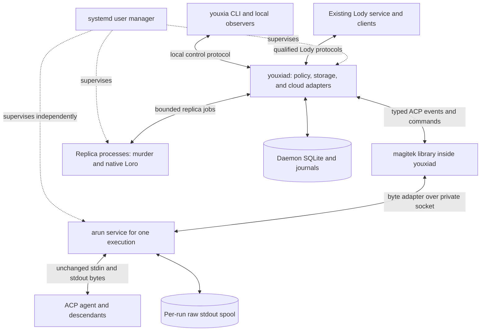
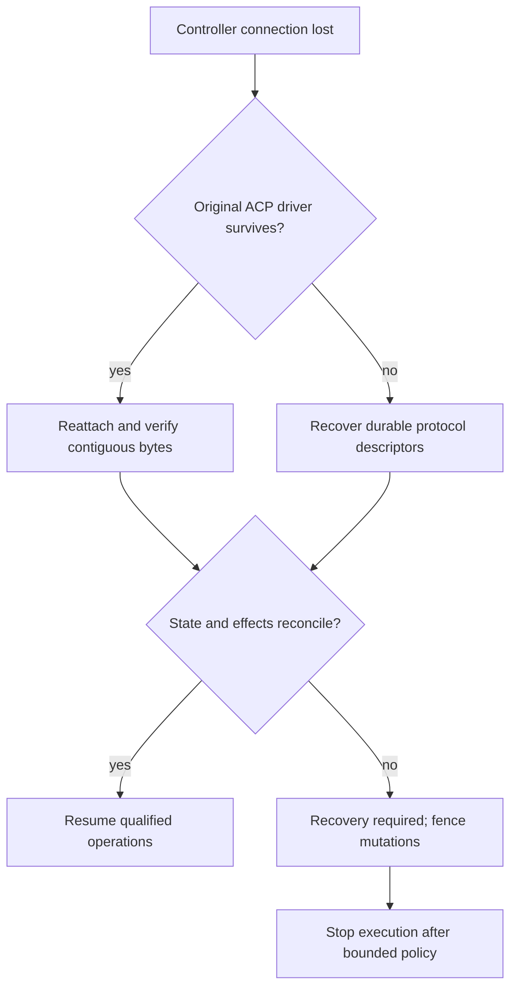

# Youxia architecture design

## Status and scope

- **Status:** Proposed target architecture; no implementation claim.
- **Date:** 2026-11-17.
- **Audience:** implementers, architecture reviewers, and Linux operators.
- **Scope:** `youxia`, `youxiad`, `magitek`, `arun`, and `murder` on a Linux
  host with systemd and unified version-2 control groups (cgroup v2).
- **Decision record:**
  [ADR 0001: Linux supervision and durable agent transport][adr].
- **Relationship to earlier design:** [RFC 0001][rfc] remains the detailed
  compatibility, persistence, and observation specification. Its §14 records
  this proposal's changes to component names, ACP ownership, process lifetime,
  and Linux deployment. Unchanged requirements, including §13's reliability
  amendments, continue to apply.
- **Normative companion:** [arun transport contract][arun-contract] defines the
  private transport semantics. [Linux resource profile][linux-profile] contains
  illustrative qualification values, not an installed configuration format.

## Contents

- [1. Problem and architectural decisions](#1-problem-and-architectural-decisions)
- [2. Evidence and compatibility contract](#2-evidence-and-compatibility-contract)
- [3. Component topology and ownership](#3-component-topology-and-ownership)
- [4. Linux service and resource topology](#4-linux-service-and-resource-topology)
- [5. Launch and control flow](#5-launch-and-control-flow)
- [6. Transport, buffering, and acknowledgement boundaries](#6-transport-buffering-and-acknowledgement-boundaries)
- [7. Recovery, shutdown, and upgrades](#7-recovery-shutdown-and-upgrades)
- [8. Durable state and synchronization](#8-durable-state-and-synchronization)
- [9. Budgets and host capacity](#9-budgets-and-host-capacity)
- [10. Security, configuration, and observability](#10-security-configuration-and-observability)
- [11. Alternatives and dependency decisions](#11-alternatives-and-dependency-decisions)
- [12. Delivery, verification, and open gates](#12-delivery-verification-and-open-gates)

## 1. Problem and architectural decisions

Youxia must run existing Lody-compatible workflows without coupling the life of
an agent to the control daemon's process. Large histories, slow
synchronization, or one noisy agent must not consume unlimited memory or
prevent unrelated control work. The compatibility target consists of observable
protocols, schemas, authorization, and workflow outcomes. It does not require
Lody's watchdog, object hierarchy, JavaScript runtime, or private storage
layout.[^1]

The design assigns five clear responsibilities:

1. `youxia` provides a command-line interface (CLI), translates human and
   automation requests into a versioned local control API, and displays durable
   receipts, results, and diagnostic evidence.
2. `youxiad` owns application policy, command acceptance, Agent Client Protocol
   (ACP) host semantics, permissions, persistent state, cloud compatibility,
   and recovery decisions.
3. `magitek` runs inside `youxiad` as the bounded ACP library. It owns protocol
   framing, negotiation, correlation, dispatch, and typed events under the
   daemon's runtime and resource policy.
4. `arun` lives beside each agent in an independent systemd service. It owns
   pipes, raw transport continuity, bounded stdout retention, stderr draining,
   and child exit evidence. It does not interpret ACP.
5. `murder` implements the native Flock-compatible metadata model and codecs.
   Replica workers use it alongside native Loro for their different replicated
   data types. It is a library, not a scheduler or process manager.

Systemd supervises service processes and controls their cgroups. The daemon
asks the manager to create and stop runs through typed D-Bus operations; it
does not implement another cgroup manager. Each agent shares its runner's
failure boundary. Preserving an agent after `arun` dies is explicitly outside
scope.

Three promises remain separate: an agent can stay alive during daemon absence;
retained bytes can be recovered; and the daemon can reconstruct enough ACP
state to continue a turn safely. The first two require `arun`. The third needs
an additional host/Magitek recovery contract and is a release gate, not an
automatic consequence of a surviving socket.

### 1.1. Goals and boundaries

The first delivery sequence remains read-only Ishiban observation, one hosted
ACP agent, and then a qualified fleet. Linux supervision enters the first
hosting slice rather than appearing only during fleet packaging. Native
metadata reads and writes remain separate compatibility gates.

The initial support profile covers an authorized, unencrypted workspace using
Loro history and a configured ACP executable. If the actual workspace needs
encryption or Roost history, that requirement becomes a prerequisite. Unknown
or unsupported histories remain visible with an explicit availability verdict.

This proposal does not create a replacement Lody cloud, desktop UI, distributed
orchestrator, container runtime, or hostile-code sandbox. It does not promise
process survival across reboot, user-manager shutdown, host loss, or runner
death. It does not make permission decisions on behalf of an absent operator.
Windows daemon supervision requires a separate platform design.

### 1.2. Terms used in the contracts

| Term                  | Definition                                                                                            |
| --------------------- | ----------------------------------------------------------------------------------------------------- |
| Compatibility profile | Selected client/service versions, data formats, capabilities, and workflows that qualification covers |
| Session               | Durable conversation identity; it can span several executions                                         |
| Run                   | One arun/agent execution lifetime, including its descendants and transport evidence                   |
| Turn                  | One prompted activity within a session; not every session update has universal turn provenance        |
| Recoverable prefix    | Contiguous retained bytes or committed effects covered by a specific cursor/checkpoint                |
| Domain owner          | Component that serializes a state transition and owns its effect/commit obligations                   |

_Table 1: Normative terms; process and protocol identities are refined in §7.1._

## 2. Evidence and compatibility contract

### 2.1. Inspected baseline

The Youxia checkout at `f6f4b46aac1f758b47036efe0af5e50e0362c866` contains the
generated application stub, RFC 0001, and its roadmap. It does not contain the
architecture described here as working software.[^2]

The useful `leynos/lody-docs` material currently lives in open PR 1, inspected
at `da27f215df33d6ee5938461d6c060acb959dd1fb`. Its architecture pins upstream
Lody `61bd9701a5ed6899a9f42787df682acfc3fd7d4b`. RFC 0001 retains its earlier
`d3179e1f...` baseline. The newer documentation informs this design without
silently redefining a deployed compatibility profile. Cloud backend internals
remain unavailable; source-level client expectations need live
qualification.[^1]

Magitek's inspected design is draft PR 1 at
`bfef49cbf10912ccf8ed246d4760bbb21f96c01b`; its main branch is a README. Its
named interfaces are proposed contracts. Wireframe's inspected native-protocol
RFCs also remain proposals. Neither dependency is treated as completed
capability merely because it has a design document.[^3][^4]

### 2.2. Preserve the external boundary

Lody separates cloud control, replicated data, and local access. Its detached
watchdog or desktop host supervises a worker, and that worker owns agent
standard input/output (stdio). Youxia preserves the selected client-visible
contracts while changing those internal process relationships.[^1]

| Boundary                        | Compatibility obligation                                                                                          | Youxia owner                                        |
| ------------------------------- | ----------------------------------------------------------------------------------------------------------------- | --------------------------------------------------- |
| Authorization and catalogue     | Supported device/API-key flows, machine identity, workspace access, revocation, and scoped Streams credentials    | `youxiad` auth and cloud adapters; CLI presentation |
| Durable Streams                 | Existing room/stream names, offsets, bootstrap, snapshots, append identity, and retry semantics                   | Daemon transport adapter and durable inbox/outbox   |
| Workspace metadata              | Flock keys, clocks, tombstones, snapshots, deltas, and durable command rows                                       | `murder` in replica workers                         |
| Conversation history            | Loro container types, schema, ownership, unknown fields, and incremental mutations                                | Native Loro in replica workers                      |
| Turn and cancellation discovery | Durable input/activation/stop routes plus RPC accelerators; common identities and authorization                   | Daemon command owner                                |
| Machine RPC                     | Strict envelopes, correlated progress/final replies, method shapes, capability negotiation, and retained outcomes | Daemon RPC adapter                                  |
| Presence                        | Correct record encoding, instance identity, and renewal/expiry behaviour                                          | Independent daemon liveness owner                   |
| ACP                             | Qualified protocol version, JSON-RPC IDs, bidirectional requests, streaming events, permissions, and cancellation | Magitek plus daemon host services                   |
| Native local API                | New versioned control, observation, receipts, and diagnostics                                                     | `youxia` and `youxiad`                              |
| Existing local Lody clients     | Protocol 7, probe/control or terminal APIs only where selected and qualified                                      | Separate optional compatibility adapters            |

_Table 2: Compatibility obligations and their implementation owners._

This matrix follows the source-backed Lody protocol documents and Magitek's host
boundary.[^5][^6][^7][^8][^9][^3] Matching session JSON is insufficient if the
conflict-free replicated data type (CRDT) container types differ. Matching
command names is insufficient if cancellation or durable discovery differs.
Conversely, stronger deduplication, bounded buffering, and explicit uncertainty
do not require reproducing documented upstream defects.

External identifiers retain upstream spelling wherever the wire requires it:
for example, workspace metadata uses `<workspaceId>:meta`, sessions use
`<workspaceId>:s:<sessionId>`, and machine requests use
`<workspaceId>:rpc:req:<machineId>`. `murder` changes the implementation name,
not those protocols.[^5][^9]

## 3. Component topology and ownership

The following diagram distinguishes process supervision from protocol traffic.
Magitek remains inside the daemon; each runner and agent belong to a separate
service. Replica processes isolate synchronous CRDT work.

_Figure 1: Control, protocol, replication, and process ownership._

The daemon owns the only SQLite writer for its state. Runners own separate
per-run files and never open the daemon database. The CLI does not maintain a
second live replica or write SQLite directly. A client disconnection releases
its response resources; it does not cancel an accepted operation.

### 3.1. `youxia`: a client with explicit lifecycle operations

The CLI owns argument parsing, OrthoConfig composition for client settings,
authentication interaction, local requests, and human/JSON output. Before work,
it negotiates the daemon protocol, capabilities, build identity, instance, and
limits. It reports the running daemon's identity separately from its own.

Existing command-family parity follows the selected workflow inventory in RFC
0001 §11.2. The following distinctions apply to the new native interface; exact
flags remain implementation work.

| Operation family                   | Required observable behaviour                                                                             |
| ---------------------------------- | --------------------------------------------------------------------------------------------------------- |
| Session create/send                | Return a stable durable receipt before reporting acceptance; result retrieval survives caller loss        |
| Observe/status/diagnose            | Report projection freshness, execution evidence, capabilities, queue age, and explicit unknown outcomes   |
| Permission/cancel                  | Address a specific operation and execution generation; separate request acceptance from terminal evidence |
| Daemon restart or maintenance stop | Detach runners after preserving state; report which runs support continuation and which need recovery     |
| Run stop or explicit stop-all      | Cancel where possible, then stop the selected service cgroups and confirm termination                     |
| Emergency service inspection       | Identify owned units from durable identity records; do not guess ownership from a PID or display name     |

_Table 3: Planned CLI behaviour; these are not implemented commands._

Authorization remains in the daemon. A repository configuration file cannot
raise ceilings, select arbitrary privileged executables, replace credentials,
or broaden filesystem permission. Existing Lody-facing lifecycle methods need
their own semantic mapping and truthful capability advertisements.

### 3.2. `youxiad`: domain and effect ownership

The daemon has separate control/liveness, I/O, storage, and maintenance owners.
The control owner has its own executor thread and network resources. It reads
bounded health snapshots and schedules presence without waiting for history
serialization, token-refresh locks, or an ordinary storage queue.

The service identity and a process-lifetime lock on the private state root
enforce one local daemon writer; alternate invocations must respect the same
lock. Generation fences reject stale work after replacement. Neither a service
name nor an advisory local lock prevents a copied installation on another host
from impersonating the same machine identity; active-active ownership remains
unsupported without a qualified remote fencing contract.

One serialized session owner handles admission, prompt delivery state,
permissions, cancellation, and terminal evidence. Each operation carries a
stable ID, execution generation, configuration generation, and reserved
completion capacity. Pure domain transitions remain testable without Tokio,
Loro, a socket, or a database driver. Adapters execute effects; domain owners
define their atomicity and uncertainty.

The storage owner performs bounded transactions on its dedicated execution
domain. Maintenance handles REST decoding, compression, repository queries,
configuration reload, and optional cleanup. A small fixed pool, initially two
replica processes, owns native Loro and murder documents. Each document has one
ordered owner; a worker restart reconstructs it before publishing readiness.

Moving a job to another thread does not remove a held lock, database
transaction, or exhausted credit. RFC 0001 §13 and the
[Comenq lessons][lessons] remain requirements for all of these owners.

### 3.3. `magitek`: protocol machinery inside the host

Magitek accepts host-owned asynchronous byte streams and independent execution
lifecycle observations. The proposed `ConnectionDriver`, client/session handles,
`EventLease`, and host-services interfaces supply a reusable bounded ACP
boundary. They do not supply daemon persistence, permission policy, process
supervision, or a private Tokio runtime.[^3]

Youxia's adapter unwraps `arun` records into unchanged agent bytes and maps
runner lifecycle evidence separately. It does not enable a second Magitek
process-spawn adapter for the same execution. The daemon remains the ACP client
even though systemd starts the runner that starts the agent.

Magitek owns frame validation, correlation, request-ID rules, reverse requests,
and bounded ordered events. The daemon owns filesystem/terminal authorization,
permission decisions, transcript commit, and Lody publication. Host service
callbacks enqueue admitted work and return promptly; they must not await work
whose reply needs the same ordered dispatcher.

Host terminal capability remains unadvertised until a run-bound execution
adapter is qualified. A terminal callback must not spawn a process into the
daemon's control cgroup. Enabling that capability requires independently
supervised terminal execution with aggregate run budgets, explicit attachment
and output ownership, stop propagation from the owning run, and recovery tests.
That adapter can use internal worker modes; it must not make `arun` interpret
ACP. Agent-created ordinary subprocesses already inherit the agent's run group.

An event lease retains its charge after dequeueing and after connection close
until the last owner releases it. The daemon reserves destination capacity
before transferring data to its journal. Delivery, protocol completion, durable
host commit, and upstream publication use separate watermarks. A final prompt
projection cannot overtake its preceding durable output.[^3]

### 3.4. `arun`: a transport keeper with one execution lifetime

One `arun` instance launches one agent executable and owns its stdin, stdout,
stderr, and direct-child reaping. The service cgroup contains the runner,
agent, and ordinary descendants. Use pipes, not a pseudo-terminal, for ACP. The
runner records process exit and stream offsets without assigning session or
turn meaning.

It keeps those pipes open when the daemon disconnects. Its versioned local
socket provides raw byte replay, fenced writes, bounded receipts, lifecycle
evidence, and explicit stop. Its stdout spool has a finite budget and a finite
unattended lifetime. Its stderr tail may truncate with recorded drop counts;
protocol stdout must not silently wrap or disappear.

The [transport contract][arun-contract] is authoritative for these semantics.
Runner restart creates a new execution; it never repairs the old one. An agent
must not outlive an unrecoverable runner failure by design.

### 3.5. `murder`: native metadata compatibility

Murder implements Flock's tuple keys, prefix access, whole-row last-writer-wins
values, clock ordering, tombstones, version summaries, JSON deltas, and binary
snapshots. Tombstones compete with writes; durable cancellation marker rows
have different semantics from deleting a row. Multi-row local batching does not
create a transaction between replicas.[^6]

The daemon's replica workers own murder instances, their clocks, and ordered
mutations. Murder does not own cloud credentials, Streams connections, command
authorization, systemd, or execution scheduling. Flock metadata can identify
pending work, but application policy authorizes and claims that work.

Naming the library does not resolve the incomplete binary-format and
clock-advancement evidence in the upstream study. Reader and writer gates need
independent upstream fixtures. Native Loro cannot replace this metadata model
merely because both expose map-shaped views.[^6][^10]

## 4. Linux service and resource topology

### 4.1. Manager and hierarchy

Use a systemd user manager for the configured host account. An unattended
installation requires lingering; logout survival is then an installation
property, not a daemon double-fork trick. The user manager still sits beneath
host-controlled ancestors. Reboot or stopping that manager ends live runs.[^11]

Systemd owns cgroups. Use services for processes and slices for aggregate
budgets. No service needs `Delegate=yes` for this design, and Youxia performs
no direct cgroup filesystem writes. A later container integration would require
its own delegation boundary.[^12]

| Unit                           | Parent                    | Lifetime and resource purpose            |
| ------------------------------ | ------------------------- | ---------------------------------------- |
| `youxia.slice`                 | User manager's root slice | Installation aggregate                   |
| `youxia-control.slice`         | `youxia.slice`            | Daemon CPU/memory/task/I/O policy        |
| `youxiad.service`              | `youxia-control.slice`    | Restartable control process              |
| `youxia-replicas.slice`        | `youxia.slice`            | Aggregate synchronous replica work       |
| `youxia-replica-<id>.service`  | `youxia-replicas.slice`   | Bounded worker incarnation               |
| `youxia-agents.slice`          | `youxia.slice`            | Aggregate agent and tool budget          |
| `youxia-agents-w<key>.slice`   | `youxia-agents.slice`     | Optional workspace budget                |
| `youxia-arun-<run-id>.service` | Selected workspace slice  | One runner, agent, and their descendants |

_Table 4: Proposed hierarchy; slices contain no application processes directly._

Workspace keys are local safe identifiers mapped durably to external workspace
IDs; never reinterpret an upstream identifier as a unit name. Run IDs use the
fixed hexadecimal encoding in the transport contract. Branch names, paths, and
untrusted display names never enter unit names.

Agent services have no `Requires=youxiad.service`, `BindsTo=youxiad.service`,
`PartOf=youxiad.service`, or equivalent stop/restart propagation. They retain
normal dependencies on their slice and host shutdown. Replica workers may share
the daemon's lifecycle because their durable state can be reconstructed; that
policy must not leak into agent units.[^13]

### 4.2. Service semantics

The runner's proposed service properties express shared fate with its agent:

| Property                             | Proposed value        | Reason                                                          |
| ------------------------------------ | --------------------- | --------------------------------------------------------------- |
| `Type` / `NotifyAccess`              | `notify` / `main`     | Runner readiness requires the endpoint and child-pipe ownership |
| `ExitType`                           | `main`                | Runner exit ends the service lifetime                           |
| `KillMode`                           | `control-group`       | Unit stop terminates remaining processes in the run             |
| `Restart`                            | `no`                  | Restart must not silently create a second execution             |
| `OOMPolicy`                          | `kill`                | A run-level memory failure ends the failure group               |
| `TimeoutStartSec` / `TimeoutStopSec` | Finite profile values | Bound startup and termination attempts                          |
| `SendSIGKILL`                        | `yes`                 | Escalate after the stop deadline                                |
| `UMask` / directory modes            | `0077` / `0700`       | Restrict local manifests, sockets, and retained output          |

_Table 5: Runner service properties; exact manager support must be qualified._

These choices follow systemd's main-process, restart, kill, and out-of-memory
semantics.[^14][^15] `youxiad` may use `Restart=on-failure` with start rate
limits; its replacement first reconciles existing runs. Replica restart policy
may reconstruct a known replica identity with a new generation. It must not
restart agent work as a side effect.

Systemd readiness is transport readiness, not ACP readiness. A runner can be
ready while initialization, authentication, or a permission interaction still
blocks the session. A stop request also does not prove all processes exited: an
uninterruptible descendant can delay termination. Retain the reservation and
report unresolved ownership until manager/cgroup evidence confirms exit.

### 4.3. Typed systemd adapter and host qualification

The daemon uses the user manager's D-Bus API for unit creation, properties,
jobs, and lifecycle observations. `StartTransientUnit` accepts a job, not a
durable application receipt. An ambiguous reply requires querying the same
unit/run identity. Never replace an existing unit to resolve a lost launch
acknowledgement.[^16]

Use structured `ExecStart` arguments with a fixed runner binary and validated
manifest reference. Map profile units explicitly: for example, a percentage
quota maps to `CPUQuotaPerSecUSec`, while memory properties use bytes. Validate
arithmetic and ranges before calling the manager. Do not invoke a shell or
parse human-readable `systemctl status` output in the production adapter.

Before hosting, probe unified cgroup v2, the required controllers, user-manager
access, relevant unit properties, and actual inherited limits. Verify these
after the daemon's sandbox profile applies. A property echo or systemd version
string alone does not establish enforcement. Missing mandatory controls block
new hosting admission while diagnostics and existing-state inspection remain
available.

Subscribe to manager changes, take a snapshot, and reconcile both idempotently.
Signals are hints, not an event log. Record the boot ID and systemd invocation
ID with each run. Transient units can disappear after completion or reboot, so
the daemon's durable run ledger must retain outcomes independently.[^16]

### 4.4. Paths and independent cleanup

Use X Desktop Group (XDG) paths with explicit operator overrides. `youxiad`
owns its state under `$XDG_STATE_HOME/youxia` and its own runtime directory.
Each runner owns an independent runtime directory such as
`$XDG_RUNTIME_DIR/youxia-arun-<run-id>`. Do not place runner sockets under a
directory that systemd removes when the daemon stops.[^17]

Persistent per-run manifests, stdout segments, and final evidence live below
the private state root, outside runtime directories. The daemon's storage owner
opens its own SQLite files; runners open only their own files. Garbage
collection needs durable terminal/reclamation evidence and confirms no live
unit still owns the run. Boot cleanup can remove stale sockets without
discarding unresolved durable output.

## 5. Launch and control flow

Launch is a sequence of recorded effects, not a distributed transaction:

1. The command owner validates authority, workspace, executable, cwd, and
   effective resource profile. It reserves host/workspace count, memory, raw
   spool, protocol capacity, and completion capacity before acceptance.
2. One transaction freezes command/configuration identity, the new run ID,
   intended unit name, and launch intent. The CLI can now receive a durable
   accepted receipt. Acceptance does not imply an agent has started.
3. The daemon installs the immutable private run manifest, ensures the slice
   policy, and submits the independent runner service. A crash between these
   effects leaves an intent for startup reconciliation.
4. The runner validates its manifest, opens its private endpoint/spool, and
   launches the agent with controlled arguments, cwd, and environment. It
   signals readiness only after pipe ownership and launch evidence exist.
5. The daemon verifies boot/run/invocation identity, attaches with a fenced
   controller epoch, and records transport readiness.
6. For a fresh ACP conversation, Magitek initializes and negotiates
   capabilities, then creates or loads the session as supported. Existing
   conversations use the recovery path in §7; they must not receive a fresh
   initialization.
7. The command owner journals exact prompt intent and outbound bytes before
   transport submission. Runner receipts establish pipe progress only.
8. Incoming raw bytes enter the durable inbox. Magitek produces admitted
   events; daemon transactions record domain outcomes and queue compatible
   murder/Loro mutations. Replica output enters the durable upstream outbox.

If a failure occurs before launch, release reservations only after establishing
that no run exists. If launch may have occurred, retain the run identity and
resolve it against systemd and its manifest. Unknown ownership blocks a
conflicting execution. Run capacity includes starting, live, detached,
recovering, and terminating executions until their ownership ends.

Disk accounting has a different lifetime. Completed runs with retained output
keep their spool reservation until the daemon imports and reclaims their files.
Startup reconstructs those reservations before new admission.

## 6. Transport, buffering, and acknowledgement boundaries

The runner transport carries small bounded outer records containing opaque byte
intervals. Magitek sees the reconstructed ACP JSONL stream, without private
envelope bytes or newline changes. A large ACP record may span many outer
records; the transport segment cap and ACP frame cap are distinct.

Stdout replay uses a contiguous byte cursor. The runner releases an interval
only after the daemon commits its own recoverable inbox prefix and acknowledges
it. Semantic application and protocol checkpointing can lag raw ingestion, so
the daemon retains the required inbox until its own recovery boundary advances.
Neither an arun acknowledgement nor a Magitek event watermark means that an
existing Lody peer received the update.

Outbound chunks carry stable sequences and digests. A lost receipt prompts a
query of the same sequence, not a new send. The adapter's flush contract must
report the declared runner write boundary, not silently equate local queue
admission with pipe progress. A partial write with an expired deadline poisons
the conversation; later frames cannot follow its abandoned prefix.

The same rule applies if the host abandons a logical ACP frame between two
fully written transport chunks. The daemon adapter explicitly poisons stdin or
stops the run; an apparently complete outer chunk does not make its ACP prefix
complete. Recovery must reconcile unfinished publications before admitting new
writes.

The stdout spool applies backpressure at its byte cap. If the daemon remains
absent or the agent cannot make progress beyond the declared deadline, the
runner records a specific failure and terminates the run. No finite spool
provides unlimited offline execution. Stderr has independent, explicitly lossy
retention. The detailed transfer, deduplication, and overflow rules live in the
[transport contract][arun-contract].

## 7. Recovery, shutdown, and upgrades

### 7.1. Identities that must not be conflated

| Identity                 | Changes when                                                                        | Does not establish                              |
| ------------------------ | ----------------------------------------------------------------------------------- | ----------------------------------------------- |
| Machine identity         | Explicit registration/migration policy changes it                                   | Exclusive ownership across copied installations |
| Daemon instance          | `youxiad` starts again                                                              | A new agent execution                           |
| Run/execution generation | A new runner/agent execution starts                                                 | A new conversation history                      |
| Systemd invocation ID    | The manager starts a service incarnation                                            | ACP session or prompt success                   |
| Attachment epoch         | A new fenced runner controller attaches                                             | Fresh ACP negotiation                           |
| ACP protocol generation  | A new conversation initializes, or qualified restoration preserves the old identity | Durable host effects                            |
| Output/inbox cursor      | A contiguous recoverable byte prefix commits                                        | Semantic application or peer publication        |

_Table 6: Identity and progress dimensions used in recovery._

### 7.2. Reconnect and daemon replacement

The following decision path applies while the runner remains alive. It makes
restored protocol state a separate condition from transport attachment.

_Figure 2: Surviving processes require evidence before protocol continuation._

If the original Magitek driver survives a socket loss, the byte adapter may
reattach beneath that driver after reconciling offsets and pending writes. Its
decoder, request map, and budget ledger remain alive. This is different from
giving a new driver a replacement stream.

After daemon death, recovery must reconstruct negotiated capabilities, session
routes, pending outbound requests, request-ID allocation, inbound permission
and host-service requests, completed effects, and raw/semantic checkpoints.
Persist replayable descriptors and receipts; do not propose serializing Rust
futures or retaining callback pointers across a process exit.

Magitek's current proposal treats a replacement stream as a new protocol
generation and supplies no durable restoration API. The recovery capability
therefore requires an explicit Magitek extension and a qualified daemon
adapter. Byte replay must reconstruct state without repeating a prompt,
permission answer, filesystem mutation, or terminal operation.[^3]

Until that gate passes, the advertised guarantee is bounded process and byte
survival. A restarted daemon reports `recovery_required`, retains uncertain
outcomes, and fences new protocol mutations. It may keep a run for bounded
inspection or stop it under the configured recovery policy. Starting a fresh
agent and loading a supported session restores history, not proof that the
previous turn never executed.

If the agent finishes while the daemon is absent, the runner finalizes its
spool and outstanding write receipts before exiting. After verifying that the
runner/cgroup no longer writes them, daemon recovery imports their committed
prefix and terminal evidence directly. It must not create a replacement agent
to recover old files. Missing finalization or receipt evidence remains explicit
uncertainty; semantic application still uses the qualified recovery rules.

### 7.3. Planned maintenance and deliberate termination

Planned daemon maintenance stops new admissions, checkpoints compatible state,
commits receipts, and detaches runner controllers. It then stops its replica
workers and control process. Independent runners keep their pipes open within
their recorded budgets. If a live turn cannot pass the restoration gate,
maintenance must first drain it, defer the restart, or report the explicit
interruption policy; it must not promise transparent continuation.

Stopping a run is a separate operation. Persist cancellation intent, attempt
the qualified ACP cancellation route, wait for bounded terminal evidence, and
then call the manager's stop operation as required. Confirm process/cgroup
termination before releasing ownership. A cancellation notification or
`StopUnit` job acceptance alone is insufficient.

Upgrading `youxiad` does not restart every runner. Existing arun protocol
versions remain negotiated until those runs finish or an explicit migration
stops them. Updating the runner executable affects new runs. Database and ACP
checkpoint compatibility must pass before a new daemon attaches; incompatible
rollback cannot discard journals or blindly restart uncertain prompts.

### 7.4. Failure dispositions

| Failure                                        | Required disposition                                                                                                                                        |
| ---------------------------------------------- | ----------------------------------------------------------------------------------------------------------------------------------------------------------- |
| CLI disconnects                                | Accepted operation continues; client retrieves its receipt/result later                                                                                     |
| Daemon crashes                                 | Systemd may restart it; arun retains pipes/bytes; recovery gates readiness                                                                                  |
| Runner crashes or run OOM fires                | Systemd ends the run group; retain interrupted/unknown outcomes; no automatic agent respawn                                                                 |
| Agent exits but pipe remains open              | Drain to a bounded deadline, then end remaining descendants and mark incomplete output                                                                      |
| Replica worker dies                            | Fence generation, recover durable input/checkpoint, and publish only recovered capabilities                                                                 |
| Manager or D-Bus becomes unavailable           | Freeze new launches; retain existing ownership reservations and reconcile on return                                                                         |
| Protocol bytes have a gap or poisoned prefix   | Stop using the conversation; preserve evidence and require recovery/termination                                                                             |
| Storage fills or fails                         | Reject new admission; preserve accepted work where possible; never fabricate a durable acknowledgement                                                      |
| Host reboots                                   | Record previous live runs as interrupted/unknown; do not infer success or replay prompts                                                                    |
| Temporary cloud/auth transport outage          | Preserve accepted state and retry policy under the qualified offline policy; report remote capability/freshness separately                                  |
| Proven workspace/credential/identity rejection | Fence affected authority and persist cancellation/stop obligations; terminate affected independent runs, retain journals, and reconcile unresolved outcomes |

_Table 7: Failure handling without invented execution certainty._

Explicit revocation differs from a failed network request. Lody's inspected
workspace revocation detaches cloud transports and cancels active turns. Youxia
must retire credential generations, fence new and replayed workspace mutations,
detach remote routes, and reconcile the stop of affected services. Exiting the
daemon cannot satisfy this obligation because runners survive it. Retain the
stop obligation through daemon failure until termination is known.[^18]

## 8. Durable state and synchronization

### 8.1. Authority and records

SQLite remains the daemon's initial local engine under RFC 0001 §13.1. Its
existing [storage contract](contracts/storage.sql) supplies inbox, outbox,
checkpoint, command, and projection patterns. The runner extension requires the
following additional logical records; concrete migrations belong to
implementation.

| Record                        | Key evidence retained                                                                    | Atomic obligation                                                  |
| ----------------------------- | ---------------------------------------------------------------------------------------- | ------------------------------------------------------------------ |
| Run ledger                    | Run/boot/unit/invocation identity, config digest, launch intent, reservations, lifecycle | Persist intent and reservation before external launch              |
| Runner inbox                  | Run, contiguous offsets, exact bytes, integrity evidence                                 | Commit bytes with recoverable cursor before runner acknowledgement |
| Outbound write ledger         | Semantic operation, protocol generation, exact bytes, write sequence/digest, receipt     | Commit intent before sending; retain ambiguous disposition         |
| ACP recovery checkpoint       | Versioned negotiated/session state, ID allocation, pending descriptors, applied prefix   | Never cover effects or bytes that cannot be reconstructed          |
| Host-effect/permission ledger | Request identity, authority, generation, deadline, outcome or uncertainty                | Replayed callbacks cannot repeat or broaden an effect              |
| Observation journal           | Durable event cursor and projection                                                      | Commit projection and observation together                         |

_Table 8: Logical records needed for runner and protocol recovery._

No transaction spans systemd, pipes, SQLite, and a remote service. Each
boundary needs intent, evidence, and reconciliation. Existing
`delivery_uncertain` semantics apply where a side effect may have happened
without a durable result. An arun write receipt narrows transport uncertainty;
it does not establish exactly-once external execution.

### 8.2. Lody publication and discovery

Preserve Lody's durable route: a human-input receipt, pending history, and
activation metadata make a turn discoverable. RPC accelerates discovery.
Cancellation similarly shares its identity across RPC and durable markers.
Startup rescans bounded metadata for pending work instead of relying on an
event that the old daemon might have missed.[^8]

Native Loro preserves container types, streaming text, unknown fields, and
writer ownership. Write content before publishing its activation pointer.
Murder preserves metadata conflict resolution, command rows, and deletion
semantics. Neither replica provides the local execution lock or a distributed
compare-and-swap.[^7][^6]

Replica workers return bounded updates to the storage owner. Commit exact
encoded outbound data and stable producer identity before network upload.
Advance incoming stream cursors only with their recoverable payload/checkpoint.
Retain pending causal operations, unsent mutations, and retry floors across
worker and daemon replacement. A version-vector maximum alone cannot prove that
every required earlier payload survived.[^10]

Ishiban observations continue to distinguish workflow stage, execution, archive
state, and evidence freshness. Agent survival without a working ACP controller
is a visible degraded execution condition, not a completed session or a healthy
machine. Read-only observation never publishes presence, claims work, creates
streams, or starts runners.

## 9. Budgets and host capacity

### 9.1. Kernel controls and application admission

Resource policy has three levels: installation ceilings, workspace/class
ceilings, and per-run limits. Admission also counts starting, recovering, and
draining work. A cap on each agent does not cap their sum.

| Control                              | Purpose                                                               | Limitation requiring another mechanism                        |
| ------------------------------------ | --------------------------------------------------------------------- | ------------------------------------------------------------- |
| `CPUWeight`                          | Relative competition between sibling groups                           | Does not reserve CPU or guarantee latency                     |
| `CPUQuota`                           | Ceiling on aggregate CPU time                                         | Parent quotas can throttle otherwise available child capacity |
| `MemoryHigh`                         | Apply reclaim pressure before the hard boundary                       | Does not replace allocation accounting or the hard cap        |
| `MemoryMax` / `MemorySwapMax`        | Contain run/class memory and swap exposure                            | OOM ends work; it is not graceful admission                   |
| `TasksMax`                           | Bound processes and threads                                           | Does not constrain a separate shared service                  |
| `IOWeight` or qualified device caps  | Control storage competition where supported                           | Does not reserve disk space or cap spool bytes                |
| Application credits and reservations | Bound queued/retained bytes, objects, calls, and accepted obligations | Need kernel containment for allocator/third-party overhead    |

_Table 9: Complementary resource controls, not interchangeable guarantees._

Systemd documents hierarchical controller behaviour and these resource
properties.[^19] Production qualification checks effective ancestors and the
storage device's behaviour. A sibling agent aggregate ceiling creates room
inside Youxia's allocation, but host contention can still consume it. Strict
latency guarantees require a separately qualified host allocation, potentially
including CPU placement. The example profile makes no such guarantee.

### 9.2. Bounded protocol and storage work

Count bytes as well as objects. The budget includes raw and decoded frames,
JSON structural expansion, SDK queues, pending calls, reverse requests,
permissions, issued event leases, partial writes, socket/pipe buffers, spool
indices, database write-ahead log (WAL), checkpoint staging, and allocator
margin. Credits remain attached through handoffs; copies consume capacity while
both copies exist.

Magitek must enforce bounds before unrestricted decoding or task creation.
Closing a connection must not create a fresh global ledger while old-generation
leases remain retained. The runner separately enforces its assigned raw spool
quota while the daemon is down. One paused stdin writer must not stop stderr
draining or control inspection.

Reserve completion, cancellation, and failure capacity when accepting work.
Ordinary admission cannot consume the storage space or credits needed to finish
already accepted operations. Bound operation age as well as bytes, including
queueing and cleanup. A slow byte trickle must not reset an absolute partial
frame deadline indefinitely.

The [Linux profile][linux-profile] illustrates capacity arithmetic for a
16-logical-CPU, 64-GiB qualification host. It is not a claim about Rohga or an
optimized production configuration. `config.example.toml` retains its
observation/hosting authority switch and protocol budgets; the Linux profile
adds OS and runner budgets. Conflicting or infeasible profiles fail validation.

Admission must satisfy both configurations: the effective run-count ceiling
cannot exceed the base `hosting.max_agents` or any Linux host/workspace limit.
The eight-run OS example does not lift the first hosting slice's one-agent gate.

Shared compiler/cache daemons and remote build workers consume resources in
their own services. Their costs do not automatically belong to the requesting
agent's cgroup. Give them separate budgets and coordinate compiler admission
through the existing build policy rather than claiming per-run accounting
covers them.

## 10. Security, configuration, and observability

### 10.1. Trust and configuration

The baseline uses one trusted Unix account. A same-user agent may access that
user's files, signal peers, or ask the user manager to start another service.
Cgroups organize cooperative workloads; they do not isolate hostile code.
`NoNewPrivileges` also does not transfer a daemon's restrictions to a service
requested over IPC. Apply each service's sandbox policy explicitly.[^17]

Keep cloud credentials in the daemon's credential facility/private storage. The
run manifest supplies only the agent's approved environment and required agent
credentials. It carries no daemon Streams token by default. Socket peer
credentials and private directories prevent cross-user access; the local
protocol adds instance/run checks and fencing for accidental stale peers.

Do not assume ownership of a CRDT row authorizes executing its contents. Verify
workspace authority, operation provenance, current capability, and executable
policy before dispatch. Bind permission answers to run/protocol/request
identity and the exact requested action. A stale answer cannot authorize a
replacement.

OrthoConfig resolves operator settings before service admission. Freeze the
effective run profile and execution config at acceptance. Invalid reload keeps
the previous generation. The first Linux implementation applies resource
profile changes only to new, separately validated runs and must reject an
aggregate reduction that invalidates live reservations. State paths, database
schema, replica identity, and restoration format need controlled migration.

### 10.2. Health and telemetry

Expose independent status for the daemon process, manager access, auth,
presence publication, replica progress, storage, runner attachment, ACP
readiness, and work delivery. `arun` never publishes Lody machine heartbeats on
the daemon's behalf: keeping pipes open does not establish control readiness.

The inspected Lody presence contract renews machine/active-session records at
30-second intervals with a 90-second expiry. Keep that wire behaviour while
reserving independent publication capacity. A successful ping or a connected
socket is not evidence of heartbeat delivery.[^20]

Measure scheduler lag, raw and semantic cursor lag, spool bytes/age,
outstanding writes, restored/rejected generations, request/event credits,
commit latency, replica cost, cgroup pressure/OOM, CPU throttling, and cleanup
outcomes. Use low-cardinality metrics and sampled identity-bearing traces. Keep
prompts, credentials, file contents, and raw transcripts out of default
diagnostics.

The diagnosis API returns actionable categories such as
`resource_controller_missing`, `launch_uncertain`, `runner_detached`,
`recovery_required`, `stdout_gap`, `storage_blocked`, and
`termination_pending`. It includes running build identity, profile digest,
effective limits, and the last independently verified progress points.
Telemetry exporters and journal formatting must not block protocol or liveness
owners.

## 11. Alternatives and dependency decisions

| Alternative                                      | Assessment                                                                                                                                    |
| ------------------------------------------------ | --------------------------------------------------------------------------------------------------------------------------------------------- |
| Keep agent pipes in `youxiad`                    | Simpler initially, but daemon death loses the transport owner; contradicts the requested lifetime boundary                                    |
| Copy Lody's watchdog/worker hierarchy            | Preserves an internal arrangement without supplying the requested resource or runner boundary                                                 |
| Put ACP interpretation in `arun`                 | Makes protocol state survive daemon replacement, but turns every runner into a policy/protocol host and violates the selected component split |
| Use a systemd scope for an already spawned child | Requires the daemon to own launch and early containment; a manager-created service gives one explicit launch/lifecycle owner                  |
| Automatically restart `arun`                     | Can create a new agent execution for an uncertain old command; prohibited                                                                     |
| Replace Flock metadata with Loro maps            | Changes clock, tombstone, snapshot, and command semantics; incompatible without a separate migration                                          |
| Require containers initially                     | Adds a packaging/runtime boundary that the cooperative Linux host does not require; hostile execution needs a separate isolation design       |

_Table 10: Alternatives and the reasons for the selected boundaries._

Magitek's dependency selection remains its own qualification gate. Its proposal
first evaluates the official ACP SDK and adjacent reuse before authorizing a
replacement engine. Youxia consumes the bounded Magitek contract; it does not
silently choose a different dispatcher underneath that project.[^3]

Wireframe is a candidate substrate after its native framing, full-duplex
connection driver, and budget contracts pass. Its current generic stream trait
does not make its length-delimited client runtime an ACP JSONL implementation.
Do not force ACP IDs or frames through the existing envelope shape. Require a
public-API ACP toy exercising reverse requests during a prompt, ordered output,
permissions, cancellation, structural limits, partial writes, slow consumers,
retained events across closure, and all supported transport types.[^4]

The earlier requested Wireframe amendments and ACP toy remain dependency work
until a concrete implementation and evidence exist. They are not a reason to
make `arun` parse ACP or to erase Magitek's credit/ownership requirements.

## 12. Delivery, verification, and open gates

### 12.1. Delivery order and migration

Keep [roadmap][roadmap] task identities stable and amend their contracts:

1. Foundation tasks qualify the real compatibility profile, murder reads,
   native Loro, local handshake, and Magitek's actual accounting boundaries.
2. The read-only observer remains independent of agent supervision and protocol
   restoration. Its successful gate must not imply hosting readiness.
3. Hosting tasks implement the systemd adapter and arun transport before the
   first real agent. First prove process/byte survival with truthful recovery
   status; qualify ACP restoration separately before promising live
   continuation.
4. Fleet tasks qualify aggregate admission, overload, fault recovery, diagnosis,
   and the existing 60-agent/72-hour acceptance workload on recorded hardware.
   The smaller example resource profile is not that fleet benchmark.
5. Production cutover drains the selected Lody owner and confirms termination
   before transferring machine/replica identity through an explicit migration.
   Keep databases separate. Rehearse rollback without replaying uncertain work.

Do not attempt to adopt arbitrary running Lody agent pipes: the old worker owns
them, and this architecture supplies no file-descriptor transfer protocol from
it. Existing conversations can migrate through qualified history/session
operations after their old executions stop. New Youxia runs then gain the arun
lifetime boundary.

### 12.2. Discriminating acceptance evidence

| Gate                         | Evidence that must reject the plausible broken design                                                                                                   |
| ---------------------------- | ------------------------------------------------------------------------------------------------------------------------------------------------------- |
| Native compatibility         | Differential murder snapshots/deltas/tombstones and Loro containers match pinned peers; unsupported inputs fail explicitly                              |
| Independent service lifetime | Restart only `youxiad`; same arun/agent PIDs and run identity remain, sockets remain reachable, and no duplicate agent starts                           |
| Runner shared fate           | Kill arun or trigger its cgroup OOM; prove descendants terminate or remain explicitly unresolved, without auto-reexecution                              |
| Launch uncertainty           | Lose the D-Bus reply after service creation; recover the original unit/run rather than launching another                                                |
| Byte continuity              | Split a JSONL frame across daemon/socket loss; reconstruct exact bytes, cursor, and decoder state or report a gap                                       |
| Semantic recovery            | Crash across prompt write, permission response, and host file/terminal effect; prove restored outcomes or explicit uncertainty without repeated effects |
| Saturation                   | Fill stdout, events, writes, and ordinary storage admission independently; preserve required progress or terminate with the declared disposition        |
| Controller fencing           | Deliver stale writes/permissions after reattachment or replacement; prove they cannot mutate the new owner                                              |
| Genuine resource enforcement | Exercise effective host/workspace/run limits and ancestors; record throttling/OOM and independent control progress                                      |
| Presence and replication     | Block a bulk import/storage consumer while a real peer receives heartbeat progress; preserve pending input and retry floors                             |
| Shutdown and reboot          | Confirm join/reap/cgroup evidence before reuse; classify vanished units and interrupted runs without inventing success                                  |
| Capability honesty           | Unimplemented local parity, Magitek restoration, encrypted history, or RPC methods remain unadvertised and explicitly diagnosable                       |

_Table 11: Required implementation witnesses, not completed test results._

Use deterministic barriers for individual failure windows, then end-to-end
fault combinations and soak tests. Compilation fixtures must support offline
CI; network/service compatibility tests use explicitly provisioned integration
environments. Formatting and schema checks on this document cannot establish
runtime guarantees.

### 12.3. Blocking questions and owners

| Question                                                     | Owner and required resolution                                                                                                                            |
| ------------------------------------------------------------ | -------------------------------------------------------------------------------------------------------------------------------------------------------- |
| Which deployed client/cloud/workspace profile is essential?  | Youxia compatibility work captures versions, schemas, capabilities, and real workflow fixtures                                                           |
| Can murder read and author every required Flock format?      | Murder qualification resolves format/licensing/clock gaps with independent fixtures                                                                      |
| Can Magitek restore a surviving ACP conversation?            | Magitek and Youxia define and test versioned descriptors, pending calls, ID allocation, effects, and replay; otherwise retain recovery-required fallback |
| Which Wireframe changes satisfy Magitek's complete contract? | Dependency integration proves the ACP toy and downstream credit ownership; a JSONL codec alone cannot close the gate                                     |
| What limits fit the actual Linux host and workloads?         | Operations measures effective controllers, ancestors, memory amplification, disk capacity, output rates, and control progress                            |
| Which existing local/advanced Lody features are needed?      | Workflow inventory promotes only required protocol 7, terminal, Roost, encryption, MCP, and lifecycle surfaces into release gates                        |

_Table 12: Open qualification work with explicit ownership._

## References

[^1]: [Lody architecture, inspected documentation revision](https://github.com/leynos/lody-docs/blob/da27f215df33d6ee5938461d6c060acb959dd1fb/docs/architecture/README.md),
    from [open documentation PR 1](https://github.com/leynos/lody-docs/pull/1).

[^2]: [Youxia at the inspected base revision](https://github.com/leynos/youxia/tree/f6f4b46aac1f758b47036efe0af5e50e0362c866).

[^3]: [Magitek proposed design](https://github.com/leynos/magitek/blob/bfef49cbf10912ccf8ed246d4760bbb21f96c01b/docs/magitek-design.md),
    especially transport replacement and host ownership; [draft PR 1](https://github.com/leynos/magitek/pull/1).

[^4]: [Wireframe native protocol RFCs at the inspected revision](https://github.com/leynos/wireframe/tree/6ad888595cf912e8424ea6e7573af7f76b096282/docs/rfcs),
    [roadmap](https://github.com/leynos/wireframe/blob/6ad888595cf912e8424ea6e7573af7f76b096282/docs/roadmap.md),
    and [current client runtime](https://github.com/leynos/wireframe/blob/6ad888595cf912e8424ea6e7573af7f76b096282/src/client/runtime.rs).

[^5]: [Lody data model](https://github.com/leynos/lody-docs/blob/da27f215df33d6ee5938461d6c060acb959dd1fb/docs/architecture/data-model.md)
    and [CLI authentication](https://github.com/leynos/lody-docs/blob/da27f215df33d6ee5938461d6c060acb959dd1fb/docs/cloud-api/cli-authentication.md).

[^6]: [Flock data model, including clock and source-access gaps](https://github.com/leynos/lody-docs/blob/da27f215df33d6ee5938461d6c060acb959dd1fb/docs/flock-protocol/data-model.md).

[^7]: [Loro session document](https://github.com/leynos/lody-docs/blob/da27f215df33d6ee5938461d6c060acb959dd1fb/docs/loro-documents/session-document.md)
    and [writers and merge behaviour](https://github.com/leynos/lody-docs/blob/da27f215df33d6ee5938461d6c060acb959dd1fb/docs/loro-documents/writers-and-merge.md).

[^8]: [Lody turn dispatch and cancellation](https://github.com/leynos/lody-docs/blob/da27f215df33d6ee5938461d6c060acb959dd1fb/docs/loro-documents/turn-dispatch.md).

[^9]: [Streams RPC conformance](https://github.com/leynos/lody-docs/blob/da27f215df33d6ee5938461d6c060acb959dd1fb/docs/lody-streams-rpc/conformance.md)
    and [implementation decisions](https://github.com/leynos/lody-docs/blob/da27f215df33d6ee5938461d6c060acb959dd1fb/docs/lody-streams-rpc/implementation-notes.md).

[^10]: [Flock replication and persistence](https://github.com/leynos/lody-docs/blob/da27f215df33d6ee5938461d6c060acb959dd1fb/docs/flock-protocol/replication.md)
    and [sync coordinator](https://github.com/leynos/lody-docs/blob/da27f215df33d6ee5938461d6c060acb959dd1fb/docs/flock-protocol/sync-coordinator.md).

[^11]: [loginctl: user lingering](https://www.freedesktop.org/software/systemd/man/latest/loginctl.html).

[^12]: [Systemd control group APIs and delegation](https://systemd.io/CGROUP_DELEGATION/).

[^13]: [systemd.unit: dependencies and lifecycle propagation](https://www.freedesktop.org/software/systemd/man/latest/systemd.unit.html).

[^14]: [systemd.service: readiness, main-process lifetime, restart, and OOM policy](https://www.freedesktop.org/software/systemd/man/latest/systemd.service.html).

[^15]: [systemd.kill: service-group termination and escalation](https://www.freedesktop.org/software/systemd/man/latest/systemd.kill.html).

[^16]: [Systemd D-Bus API: transient units, jobs, and properties](https://www.freedesktop.org/software/systemd/man/latest/org.freedesktop.systemd1.html).

[^17]: [systemd.exec: runtime directories and execution restrictions](https://www.freedesktop.org/software/systemd/man/latest/systemd.exec.html).

[^18]: [Lody cloud attachment and workspace revocation](https://github.com/leynos/lody-docs/blob/da27f215df33d6ee5938461d6c060acb959dd1fb/docs/loro-documents/persistence-and-sync.md#attaching-the-cloud).

[^19]: [systemd.resource-control: hierarchical resource properties](https://www.freedesktop.org/software/systemd/man/latest/systemd.resource-control.html).

[^20]: [Lody presence protocol](https://github.com/leynos/lody-docs/blob/da27f215df33d6ee5938461d6c060acb959dd1fb/docs/loro-documents/presence.md).

[adr]: adrs/adr-0001-linux-supervision-and-agent-transport.md
[arun-contract]: contracts/arun-transport.md
[lessons]: lessons-on-daemon-design-and-hot-path-preservation.md
[linux-profile]: contracts/linux-host.example.toml
[rfc]: rfcs/rfc-0001-native-rust-cli-and-daemon.md
[roadmap]: roadmap.md
